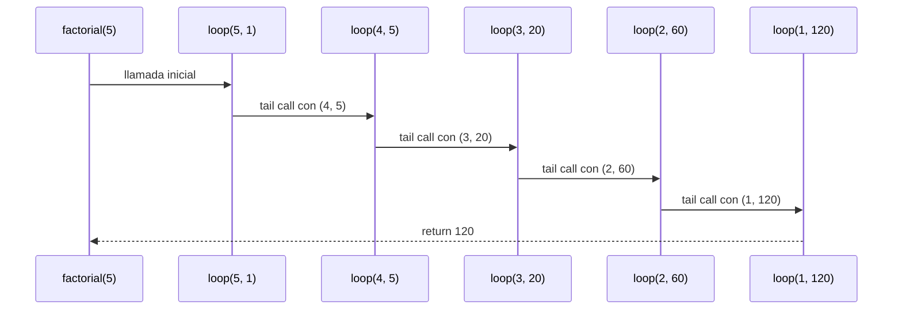
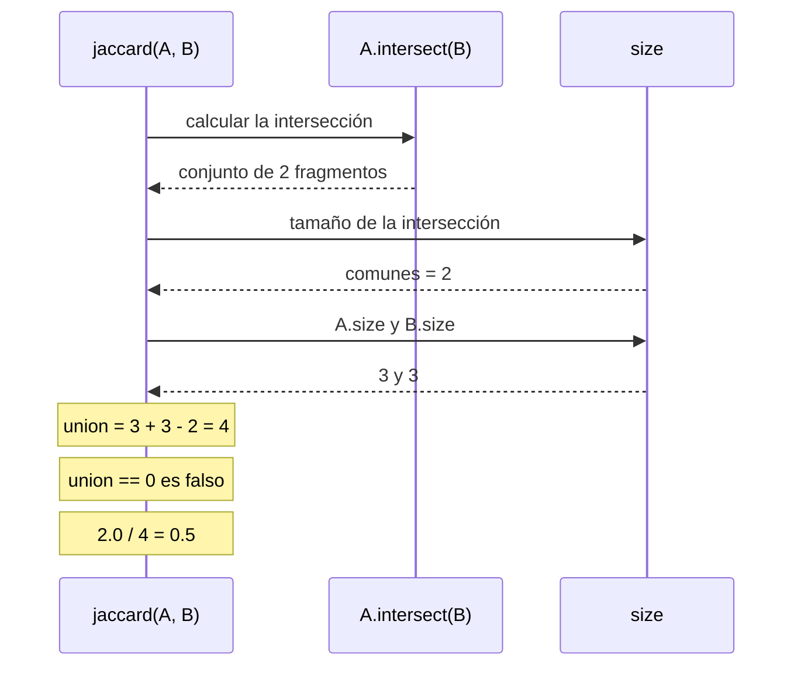
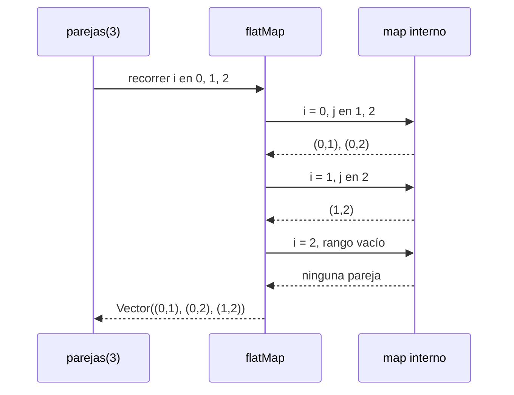
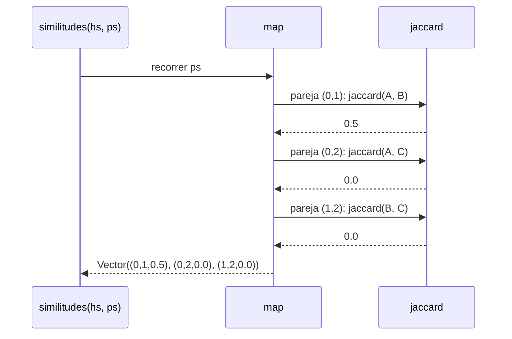

# Algoritmo Factorial con Recursión de Cola

## Definición del Algoritmo

```Scala
def factorial(n: Int): BigInt = {
  @annotation.tailrec
  def loop(x: Int, acumulador: BigInt): BigInt = {
    if (x <= 1) acumulador
    else loop(x - 1, acumulador * x)
  }
  loop(n, 1)
}
```

* La función `factorial` calcula el factorial de un número `n` utilizando **recursión de cola**.
* La función interna `loop` es la que hace la recursión:

  * Recibe dos parámetros:

    * `x`: el valor actual decreciente hasta llegar a 1.
    * `acumulador`: donde se guarda el resultado parcial en cada paso.
* El decorador `@annotation.tailrec` obliga a que la función sea optimizada como recursión de cola, es decir, **no se acumulan llamados en la pila**.

## Explicación paso a paso

### Caso base

```Scala
if (x <= 1) acumulador
```

Cuando `x` llega a `1`, la función retorna directamente el valor acumulado, evitando más llamadas.

### Caso recursivo

```Scala
loop(x - 1, acumulador * x)
```

En cada llamada:

* Se reduce el valor de `x` en 1.
* Se multiplica el acumulador por `x` y se pasa a la siguiente iteración.
* Como es recursión de cola, la llamada recursiva es la **última instrucción** en ejecutarse, lo que permite a Scala optimizar la pila.

---

## Llamados de pila en recursión de cola

Ejemplo:

```Scala
factorial(5)
```

### Paso 1: Llamada inicial

```Scala
loop(5, 1)
```

### Paso 2: Primera iteración

```Scala
loop(4, 5)   // acumulador = 1 * 5
```

### Paso 3: Segunda iteración

```Scala
loop(3, 20)  // acumulador = 5 * 4
```

### Paso 4: Tercera iteración

```Scala
loop(2, 60)  // acumulador = 20 * 3
```

### Paso 5: Cuarta iteración

```Scala
loop(1, 120) // acumulador = 60 * 2
```

### Paso 6: Caso base

```Scala
return 120
```

---

## Diferencia con recursión normal

* En **recursión normal** cada llamada queda en la pila esperando a que termine la siguiente, lo que puede causar desbordamiento si `n` es muy grande.
* En **recursión de cola**, el compilador transforma el proceso en un **bucle optimizado**, por lo que no se guarda cada llamada en la pila y el algoritmo puede ejecutarse para valores muy grandes sin problema.

---

## Ejemplo de uso

```Scala
val resultado = factorial(5)
println(resultado)  // 120
```

El resultado de `factorial(5)` es `120`.


## Diagrama de llamados de pila con recursión de cola



---

# Informe de procesos: `jaccard`, `parejas` y `similitudes`

Estas tres funciones no son recursivas. Se resuelven con operaciones sobre
colecciones inmutables y funciones de alto orden (`flatMap` y `map`), así que el
proceso que generan no hace crecer la pila con el tamaño de la entrada: cada
función abre un número fijo de llamados, sin importar cuántos documentos o
parejas reciba. Por eso, en lugar de una pila que se apila y se desapila, lo que
se muestra para cada una es la evaluación paso a paso con el modelo de
sustitución y el orden en que se hacen los llamados.

## `jaccard`

```scala
def jaccard(h1: Huella, h2: Huella): Double = {
  val comunes = h1.intersect(h2).size
  val union = h1.size + h2.size - comunes
  if (union == 0) 0.0 else comunes.toDouble / union
}
```

La función es una secuencia de tres pasos dentro de un bloque `{ ... }`. Los dos
primeros guardan un resultado intermedio en un `val`, y el tercero es una
expresión `if / else` cuyo valor es el resultado de la función. No hay
asignaciones que cambien ni `return`.

### Ejemplo

Con $k = 2$, sean

```math
A = \{(a,b),\ (b,c),\ (c,d)\} \qquad B = \{(b,c),\ (c,d),\ (d,e)\}
```

La evaluación de `jaccard(A, B)` es:

| Paso | Expresión | Valor |
|---|---|---|
| 1 | `A.intersect(B)` | el conjunto con `(b,c)` y `(c,d)` |
| 2 | `comunes = A.intersect(B).size` | `2` |
| 3 | `union = A.size + B.size - comunes` | `3 + 3 - 2 = 4` |
| 4 | `union == 0` | `false` |
| 5 | `comunes.toDouble / union` | `2.0 / 4 = 0.5` |

En el paso 5 importa el `toDouble`: sin él, `2 / 4` sería una división entre
enteros y daría `0`.

### Orden de los llamados



Cada llamado termina y devuelve antes de que empiece el siguiente, así que la
pila nunca tiene más de dos marcos: el de `jaccard` y el de la operación de
conjuntos que esté en curso.

## `parejas`

```scala
def parejas(n: Int): Vector[Pareja] =
  for {
    i <- (0 until n).toVector
    j <- i + 1 until n
  } yield (i, j)
```

### En qué se traduce el `for`

La expresión `for` con `yield` no es un ciclo imperativo: es azúcar sintáctico.
El compilador traduce cada generador, menos el último, a un `flatMap`, y el
último a un `map`. Con dos generadores queda:

```scala
(0 until n).toVector.flatMap(i => (i + 1 until n).map(j => (i, j)))
```

- El `map` interno recibe un `i` fijo y construye la fila de parejas que empiezan
  en ese `i`.
- El `flatMap` externo aplica esa función a cada `i` y concatena las filas en un
  solo vector, en el orden en que se recorren.
- El `toVector` del primer generador hace que el resultado sea un `Vector`, que
  es el tipo que pide la firma.

Las dos son funciones de alto orden: reciben como argumento una función anónima
(`i => ...` y `j => (i, j)`).

### Ejemplo: `parejas(3)`

| `i` | Rango de `j` (`i + 1 until 3`) | Fila que produce el `map` |
|---|---|---|
| 0 | 1, 2 | `(0,1)`, `(0,2)` |
| 1 | 2 | `(1,2)` |
| 2 | vacío | ninguna |

El `flatMap` concatena las tres filas y el resultado es
`Vector((0,1), (0,2), (1,2))`.



Cada llamado al `map` interno devuelve antes de pasar al siguiente `i`. La
profundidad de la pila es siempre la misma (`parejas`, `flatMap`, la función
anónima y su `map`), sea cual sea `n`. Lo que crece con `n` es la cantidad de
veces que se repite ese ciclo de llamar y devolver, no la altura de la pila.

Cuando `n` es 0 o 1, el rango externo no tiene elementos o el único rango interno
es vacío, y el resultado es el vector vacío sin necesidad de un caso especial.

## `similitudes`

```scala
def similitudes(hs: Vector[Huella], ps: Vector[Pareja]): Vector[Medicion] =
  ps.map { case (i, j) => (i, j, jaccard(hs(i), hs(j))) }
```

`map` es la función de alto orden: recorre el vector de parejas y aplica a cada
una la función anónima que recibe. Esa función usa reconocimiento de patrones
(`case (i, j)`) para separar la pareja en sus dos posiciones, busca las dos
huellas en `hs` y arma la medición con el resultado de `jaccard`. Como `map`
devuelve un vector nuevo del mismo tamaño y en el mismo orden, hay exactamente
una medición por cada pareja recibida.

### Ejemplo

Sean tres huellas, con $A$ y $B$ las mismas del ejemplo de `jaccard`:

```math
hs = \langle A,\ B,\ C \rangle \qquad C = \{(x,y)\} \qquad ps = \langle (0,1),\ (0,2),\ (1,2) \rangle
```

| Pareja | Llamado | Medición |
|---|---|---|
| `(0,1)` | `jaccard(A, B)` | `(0, 1, 0.5)` |
| `(0,2)` | `jaccard(A, C)` | `(0, 2, 0.0)` |
| `(1,2)` | `jaccard(B, C)` | `(1, 2, 0.0)` |



De nuevo la pila tiene altura constante: `similitudes`, `map`, la función
anónima y `jaccard`. Cada llamado a `jaccard` termina antes de que empiece el
de la pareja siguiente.

Esta función es la que concentra el trabajo de la solución directa: se llama a
`jaccard` una vez por pareja, y con $n$ documentos hay $n(n-1)/2$ parejas. Como
cada medición depende solo de su pareja y no de las demás, los llamados son
independientes entre sí, y eso es lo que permite repartirlos después en la
versión paralela.


